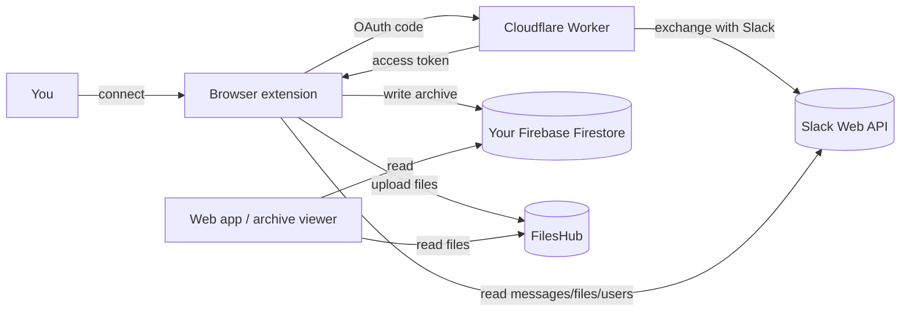

# Architecture

SlackVault is a **zero-server** product in the sense that it keeps none of your data: the work
happens in your browser and in your own cloud accounts. It's built from four cooperating surfaces.

## The four surfaces

| Surface | Responsibility | Tech |
|---------|----------------|------|
| **Website / web app** | Product site, onboarding, archive viewer (browse / search / export). Also an Android app. | React 19, TypeScript, Vite, Radix UI, TanStack Router/Query, Capacitor, Firebase |
| **Browser extension** | Performs the actual Slack sync locally; talks to the Slack Web API and writes to your Firebase. | WXT, Manifest V3, React, TypeScript |
| **Cloudflare Worker** | Handles **only** the Slack OAuth code exchange and token refresh — so the Slack client secret never reaches the browser. | Cloudflare Workers, TypeScript |
| **Slack app** | The app definition + read-only OAuth scopes you install into your workspace. | Slack app manifest |

## How the pieces connect

## The OAuth flow

1. The extension starts OAuth and sends the user to Slack to authorize.
2. Slack redirects back with a temporary **code**.
3. The extension passes the code to the **Cloudflare Worker**, which exchanges it with Slack using
   the **client secret** (held only in the worker).
4. The worker returns the access token to the extension, which stores it in encrypted browser
   storage.
5. The worker also handles **token refresh** when needed.

This split is the whole point of the worker: **Slack API calls happen only in the extension, and
the Slack client secret lives only in the worker** — never in the website or the extension bundle.

## Where data lives

- **Firestore (your project)** — messages, channels, users, file metadata, workspace meta.
- **FilesHub** — the actual file attachments.
- **Browser extension storage** — your Slack OAuth token (encrypted by the browser).

SlackVault operators never see any of it.

## Zero-cost design

Every surface fits within a free tier:

- Firebase free tier (1 GiB storage, 50K reads/day, 20K writes/day).
- Cloudflare Workers free tier for the OAuth exchange.
- FilesHub for file storage.
- The extension does the heavy lifting client-side, so there's no server compute to pay for.

This is also why a **Google Drive storage adapter is intentionally not built** — FilesHub keeps the
architecture zero-cost with one external store.

For the exact Firestore layout, see the [Data model](/reference/data-model); for Slack API usage and
limits, see [Slack API & rate limits](/reference/api-and-rate-limits).
